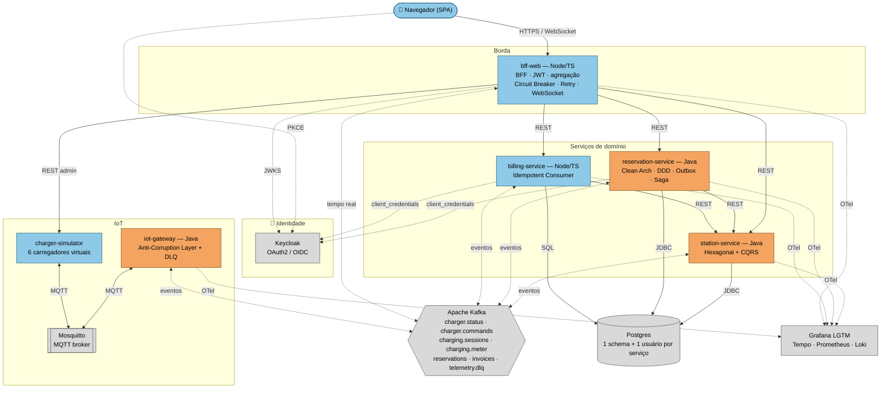

# ⚡ VoltHub — rede de recarga de veículos elétricos

Trabalho final da disciplina **Arquitetura de Software Multiplataforma** (PUC Minas).

O VoltHub é uma plataforma para uma rede de eletropostos. O motorista encontra um carregador livre,
reserva, chega, libera a recarga pelo app e acompanha os kWh em tempo real. No fim, recebe a fatura.
Os carregadores são equipamentos IoT que falam **MQTT**. Os serviços conversam por **Kafka** e **REST**,
e o navegador recebe atualizações por **WebSocket**.

## Arquitetura



Fluxo: o motorista encontra um carregador livre, reserva, chega, libera a recarga pelo app e acompanha
os kWh em tempo real; no fim, recebe a fatura. Linhas sólidas são chamadas síncronas (REST/JDBC),
linhas tracejadas são comunicação assíncrona/observabilidade (Kafka, OTel, OIDC) e as setas duplas em
`iot-gateway ↔ Mosquitto` são a ponte **MQTT**. Laranja = serviços Java, azul = serviços Node/TypeScript,
cinza = infraestrutura.

## Serviços

| Serviço | Stack | Porta | Responsabilidade | Patterns principais |
|---|---|---|---|---|
| `bff-web` | Node 22 / TypeScript / Fastify | 3000 | Porta única do app: JWT, agregação, tempo real, serve o SPA | BFF, Circuit Breaker, Retry, Timeout, degradação graciosa |
| `station-service` | Java 21 / Spring Boot | 8001 | Cadastro de estações e mapa de disponibilidade | Arquitetura Hexagonal, CQRS (read model por eventos) |
| `reservation-service` | Java 21 / Spring Boot | 8002 | Reservas e ciclo da recarga | Clean Architecture, DDD tático, Transactional Outbox, Saga coreografada, Idempotent Consumer |
| `iot-gateway` | Java 21 / Spring Boot | 8003 | Ponte MQTT ↔ Kafka | Protocol Gateway, Anti-Corruption Layer, Dead Letter Queue |
| `billing-service` | Node 22 / TypeScript | 8004 | Faturamento das sessões | Idempotent Consumer, Outbox simplificado, OAuth2 Client Credentials |
| `charger-simulator` | Node 22 / TypeScript | 8005 | 6 carregadores virtuais (MQTT) | Last Will and Testament, QoS 1, mensagens retidas |

Infraestrutura: Kafka 3.9 (KRaft) + Kafka UI, Mosquitto 2, Keycloak 26, Postgres 16, Grafana LGTM (OpenTelemetry Collector, Tempo, Prometheus, Loki).

## Como subir

**Pré-requisitos:** Docker Desktop com **8 GB de RAM** disponíveis para os containers.

- **Windows com backend WSL2 (recomendado):** a RAM é definida em `%UserProfile%\.wslconfig`
  (`[wsl2]` e na linha seguinte `memory=8GB`; depois `wsl --shutdown`). Rode os comandos no terminal do
  **Ubuntu (WSL2)**, com a pasta copiada para dentro do Linux (ex.: `~/volthub`).
- **Windows com backend Hyper-V:** a RAM é definida em Settings → Resources. Rode os scripts no
  **Git Bash**; os scripts de demo precisam de `python3` instalado.
- **Linux/macOS:** basta o Docker com 8 GB.

```bash
chmod +x start.sh stop.sh scripts/*.sh
./start.sh          # 1ª vez: 5 a 10 min (baixa imagens e compila os serviços)
```

| O quê | Endereço | Login |
|---|---|---|
| **App VoltHub** | http://localhost:3000 | `motorista@volthub.com` / `motorista123` · `operador@volthub.com` / `operador123` |
| Grafana (dashboard "VoltHub") | http://localhost:3001 | acesso anônimo |
| Kafka UI | http://localhost:8090 | — |
| Keycloak | http://localhost:8081 | `admin` / `admin` |
| Swagger (OpenAPI) | http://localhost:8001/swagger-ui.html · http://localhost:8002/swagger-ui.html | — |
| API do simulador | http://localhost:8005/chargers | — |

Parar: `./stop.sh` (mantém dados) ou `./stop.sh --limpar` (apaga tudo).

## Roteiro da demonstração

| # | O que mostrar | Como |
|---|---|---|
| 1 | Login com PKCE, 401 e 403 | `./scripts/demo-seguranca.sh` e login no app |
| 2 | Saga completa: reserva → recarga ao vivo → fatura | No app (motorista) ou `./scripts/demo-fluxo-completo.sh` |
| 3 | Compensação: carregador quebra com reserva ativa | App do operador → "Simular falha", ou `./scripts/demo-compensacao.sh` |
| 4 | DLQ: telemetria corrompida não trava o fluxo | `./scripts/demo-dlq.sh` |
| 5 | Circuit breaker abrindo e fechando | `./scripts/demo-resiliencia.sh` |
| 6 | Trace atravessando HTTP → Outbox → Kafka → MQTT | Grafana → Explore → Tempo |
| 7 | Kubernetes: self-healing | `k8s/README.md` |

## Onde está cada conceito da disciplina

| Aula | Conceito | Onde no código |
|---|---|---|
| 1 | C4 (contexto, container, componente) | `docs/c4/` e slides |
| 1 | Contratos | `docs/asyncapi.yaml` (eventos) · OpenAPI gerado do código: http://localhost:8001/swagger-ui.html e :8002 |
| 2 | OAuth2/OIDC, JWT, roles, 401/403 | `infra/keycloak/volthub-realm.json`, `bff-web/src/auth.ts`, `*/SecurityConfig.java` |
| 2 | Clean Architecture | `reservation-service/.../{domain,application,infrastructure}` |
| 2 | DDD: Aggregate, VO, Domain Event, Domain Service, Repository | `reservation-service/.../domain/` (`Reservation`, `HoldPeriod`, `BookingPolicy`…) |
| 2 | Database per Service | `infra/postgres/init.sql` (schema + usuário por serviço) |
| 3 | CQRS | `station-service` (`charger_availability` = read model) e Commands/Queries no `reservation-service` |
| 3 | Kafka: tópicos, partições, chaves, consumer groups | `infra/kafka/create-topics.sh`, listeners de cada serviço |
| 3 | Observer | Kafka consumer groups; WebSocket no `bff-web/src/realtime.ts` |
| 3 | PKCE | `bff-web/public/app.js` (feito "na unha", sem biblioteca) |
| 3 | Hexagonal | `station-service/.../{application/port,adapter}` |
| 4 | OpenTelemetry, Grafana, Tempo, Prometheus, Loki | `docker-compose.yml` (lgtm), `infra/grafana/`, `TraceContext.java`, `telemetry.ts` |
| 4 | Docker multi-stage, Kubernetes | `services/*/Dockerfile`, `k8s/` |
| 4 | CI/CD | `.github/workflows/ci.yml` |
| 5 | BFF, Circuit Breaker, Retry, Timeout | `bff-web/src/downstream.ts`, Resilience4j em `reservation-service` |
| 5 | Versionamento de API | prefixo `/v1` em todos os serviços |
| 5 | AsyncAPI | `docs/asyncapi.yaml` |
| extra | IoT/MQTT, Saga, Outbox, DLQ, Idempotência | `iot-gateway`, `OutboxRelay.java`, `ChargingSagaHandler.java` |

Decisões de arquitetura registradas em `docs/adr/`.

## Testes

```bash
# Java (domínio puro, sem Spring nem banco)
cd services/reservation-service && mvn test
cd services/station-service && mvn test
cd services/iot-gateway && mvn test
# Node
cd services/billing-service && npm ci && npm test
cd services/bff-web && npm ci && npm test   # retry, circuit breaker
```

O pipeline `.github/workflows/ci.yml` roda esses testes, valida o AsyncAPI e os manifests Kubernetes
e faz o build de todas as imagens a cada push.

## Estrutura

```
volthub/
├── docker-compose.yml        ← sobe tudo
├── start.sh / stop.sh
├── infra/                    ← Keycloak (realm), Postgres, Kafka (tópicos), Mosquitto, Grafana
├── services/
│   ├── station-service/      ← Java · hexagonal + CQRS
│   ├── reservation-service/  ← Java · Clean + DDD + Outbox + Saga
│   ├── iot-gateway/          ← Java · MQTT ↔ Kafka
│   ├── billing-service/      ← Node/TS · faturamento
│   └── bff-web/              ← Node/TS · BFF + SPA (public/)
├── simulator/                ← Node/TS · carregadores MQTT
├── k8s/                      ← manifests Kubernetes
├── docs/                     ← AsyncAPI, ADRs, diagramas C4
├── scripts/                  ← demos
└── .github/workflows/        ← CI
```
