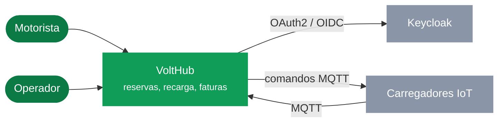
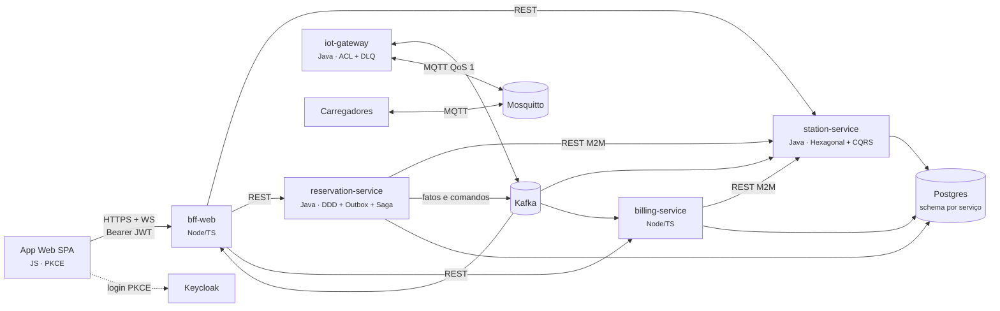
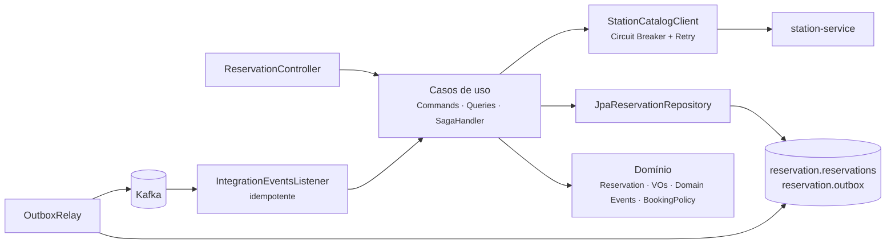

# Diagramas C4

O modelo completo está em [`workspace.dsl`](workspace.dsl) (Structurizr). As versões abaixo usam
Mermaid e aparecem desenhadas direto no GitHub. Nos slides, os mesmos diagramas estão feitos com
formas editáveis.

## Nível 1 — Contexto

## Nível 2 — Containers

## Nível 3 — Componentes do reservation-service

A dependência sempre aponta para dentro: o domínio não conhece Spring, JPA nem Kafka.
